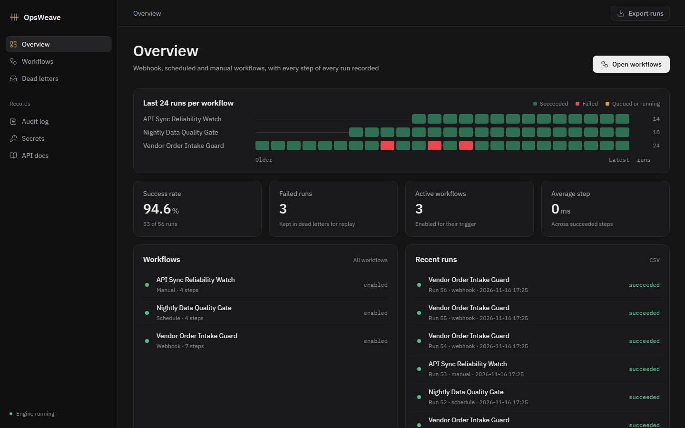
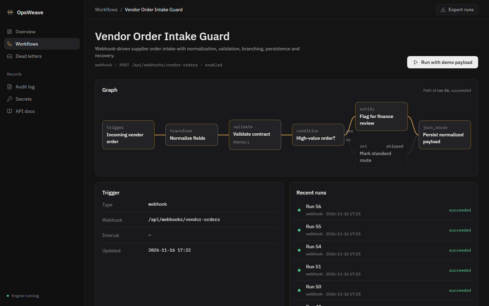
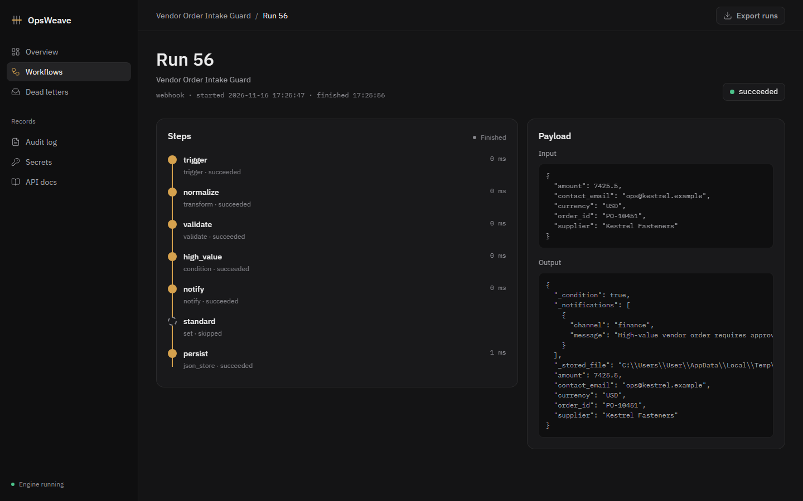
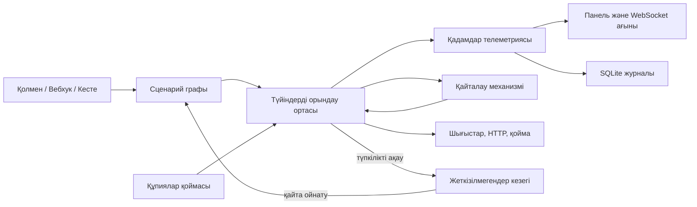

<div align="center">

# OpsWeave

**Әр қадамды жазатын, қайталауға болатынды қайталайтын және құлағанды қайта ойнатуға болатындай сақтайтын автоматтандыру.**

[English](README.md) · [Русский](README.ru.md) · [Қазақша](README.kk.md)


</div>

<p align="center">
  
</p>

## Бұл не

Көп автоматтандыру скриптен басталады, кейін сенімділік керек болады: кестелер, қайталаулар, құпиялар, әрекеттер журналы және ақауларды қайта ойнату тәсілі. OpsWeave бұл келесі қадамды бір дербес жобада береді.

Автоматтандыруды қадамдар графы ретінде сипаттайсыз. Ол бір шертуден, вебхуктен немесе кесте бойынша іске қосылады. Әр қадам орындалу уақытымен және кіріс пен шығыстың хэшімен жазылады. Уақытша ақаулар қайталанады. Түпкілікті құлаған іске қосу бастапқы деректерді жеткізілмегендер кезегінде қалдырады, сіз деректі түзетіп, қайта ойната аласыз.

| Бөлік | Не істейді |
|---|---|
| **Сценарий графы** | Иә/жоқ тармақтары бар DAG түріндегі қадамдар |
| **Триггерлер** | Қолмен, вебхук (идемпотенттілік кілттерімен) және кесте бойынша |
| **Іске қосулар тарихы** | Әр қадамның әр әрекеті: кідіріс, қате, деректер хэштері |
| **Жеткізілмегендер** | Құлаған деректер бір реттік қайта ойнату үшін сақталады |
| **Құпиялар қоймасы** | Шифрланған мәндер, түйін баптауында `${SECRET:NAME}` ретінде қолданылады |
| **Тірі көрініс** | Орындалу кезінде іске қосудың WebSocket ағыны |

## Скриншоттар

<table>
  <tr>
    <td width="50%"><br><sub>Сценарий графы. Соңғы іске қосу жолы охрамен, өткізілген тармақ үзік сызықпен сызылған</sub></td>
    <td width="50%"><br><sub>Іске қосу: барлық қадам бір жолда, әрекеттерімен, кідірісімен және қатесімен</sub></td>
  </tr>
</table>

## Іске қосу қалай өтеді



## Түйін түрлері

| Түйін | Мақсаты |
|---|---|
| `trigger` | Іске қосудың кіру нүктесі |
| `set` | Деректерге тұрақты өрістер қосу |
| `transform` | Мәндерді қалыпқа келтіру, түрлендіру және атын өзгерту |
| `validate` | Міндетті өрістер, regex, диапазондар, рұқсат етілген мәндер |
| `condition` | Іске қосуды иә/жоқ қабырғалары бойынша бағыттау |
| `http` | Сыртқы JSON API шақыру |
| `delay` | Қадамды кідірту |
| `notify` | Іске қосуға операциялық хабарлама тіркеу |
| `json_store` | Деректерді келесі жүйе үшін JSON артефакт ретінде сақтау |

Әр түйіннің өз қайталау саясаты бар: әрекеттер арасында 0-ден 30 секундқа дейін үзіліспен 5 қайталауға дейін.

## Жылдам бастау

```bash
python -m venv .venv
source .venv/bin/activate  # Windows: .venv\Scripts\activate
pip install -r requirements.txt
python scripts/seed_demo.py
uvicorn app.main:app --reload
```

| Не | Мекенжай |
|---|---|
| Панель | `http://127.0.0.1:8000` |
| API құжаттамасы | `http://127.0.0.1:8000/docs` |
| Health | `http://127.0.0.1:8000/api/health` |

Скрипт үш сценарий жасайды:

| Сценарий | Триггер | Нені көрсетеді |
|---|---|---|
| **Vendor Order Intake Guard** | Вебхук | Қалыпқа келтіру, келісімшартты тексеру, ірі тапсырыстар тармағы, сақтау |
| **Nightly Data Quality Gate** | Кесте | Жаңалықты тексерумен күй суреті |
| **API Sync Reliability Watch** | Қолмен | Қайталаулармен және жеткізілмегендер қорғанысымен қайта қолданылатын синхрондау тексерісі |

## Байқап көріңіз

Демо вебхукке тапсырыс жіберіңіз:

```bash
curl -X POST http://127.0.0.1:8000/api/webhooks/vendor-orders \
  -H 'Content-Type: application/json' \
  -d '{
    "order_id": "PO-1042",
    "supplier": "Northstar Components",
    "amount": "7425.50",
    "currency": "usd",
    "contact_email": " OPS@NORTHSTAR.EXAMPLE "
  }'
```

Іске қосу деректерді қалыпқа келтіреді, тексереді, тапсырысты ірі деп жатқызады, қаржы бөліміне хабарлама тіркейді және қорытынды артефактіні сақтайды.

Қалпына келуді көру үшін жарамсыз email жіберіңіз. Тексеру қадамы өз саясаты бойынша қайталайды, іске қосу қатемен аяқталады, ал бастапқы деректер **Dead letters** ішінде пайда болады. Түзетіп, қайта ойнатыңыз.

## Осы нұсқада жаңалары

| Не | Қазір қалай жұмыс істейді |
|---|---|
| Беттер | Интерфейстің барлық беттері өзекті Starlette-те көрсетіледі |
| Сценарийді жою | Онымен бірге оның іске қосулары, қадамдары және жеткізілмегендері жойылады |
| Сценарийді сақтау | Циклдар, slug-сыз вебхук, аралықсыз кесте және қайталанған slug түсінікті `400` арқылы қабылданбайды |
| Жаңартулар | `PATCH` қателері `400`, ал `"definition": null` өңделеді |
| Бұзылған сипаттамалар | Енді тексеруден өтпейтін сақталған сипаттама іске қосуды қатемен аяқтап, жеткізілмегендерде жазба жасайды, кезекте мәңгі күтпейді |
| Қайта іске қосу | Процесс тоқтағаннан кейін кезекте немесе жұмыста қалған іске қосулар іске қосылғанда құлаған деп белгіленіп, жеткізілмегендерге түседі |
| Жоспарлаушы | Сәтсіз тактіден аман өтеді және алдыңғысы кезекте немесе жұмыста тұрғанда жаңа іске қосуды жинамайды |
| Қайта ойнату | Жеткізілмеген жазбаны бір рет қайта ойнатуға болады. Екінші қайта ойнату `409` қайтарады |
| Құпиялар | Басқа `OPSWEAVE_SECRET_KEY` астында сақталған мән түсінікті қате береді |
| Интерфейс | Графит тақырыбы. Әр сценарийде соңғы 24 іске қосу жолағы бар, граф соңғы іске қосу жолын көрсетеді, іске қосу қадамдарды бір жолда көрсетеді |

## Құпиялар қоймасы

```bash
curl -X POST http://127.0.0.1:8000/api/secrets \
  -H 'Content-Type: application/json' \
  -d '{"name":"CRM_TOKEN","value":"secret-value"}'
```

Түйінде қолдану:

```json
{
  "headers": {
    "Authorization": "Bearer ${SECRET:CRM_TOKEN}"
  }
}
```

Құпиялар SQLite-қа түспес бұрын шифрланады. Тізімдер мәнді ешқашан қайтармайды.

## Жазуды қорғау

`OPSWEAVE_WRITE_API_KEY` орнатыңыз. Одан кейін сценарий өзгерістері, қолмен іске қосулар, қайта ойнатулар және құпияларды жазу тақырып талап етеді:

```text
X-OpsWeave-Key: your-key
```

Вебхук маршруттары сыртқы жүйелер шақыра алуы үшін ашық қалады.

## API

| Әдіс | Жол | Мақсаты |
|---|---|---|
| `GET` | `/api/health`, `/api/stats` | Денсаулық және шолу сандары |
| `GET` `POST` | `/api/workflows` | Сценарийлер тізімі және жасау |
| `GET` `DELETE` | `/api/workflows/{id}` | Сценарийді оқу немесе жою |
| `POST` | `/api/workflows/{id}/run` | Қолмен іске қосу |
| `POST` | `/api/webhooks/{slug}` | Вебхук арқылы іске қосу, `X-Idempotency-Key` қолдау көрсетіледі |
| `GET` | `/api/runs`, `/api/runs/{id}` | Қадамдарымен іске қосулар тарихы |
| `POST` | `/api/runs/{id}/replay` | Іске қосуды қайта ойнату |
| `GET` | `/api/dead-letters` | Құлаған деректер |
| `POST` | `/api/dead-letters/{id}/replay` | Жеткізілмеген жазбаны бір рет қайта ойнату |
| `GET` `POST` | `/api/secrets` | Атаулар тізімі, құпияны сақтау |
| `GET` | `/api/runs-export.csv` | Іске қосулар тарихы CSV түрінде |
| `GET` | `/api/audit` | Аудит журналы |
| `WS` | `/ws/runs/{id}` | Іске қосудың тірі жаңартулары |

## Не сақталады

Сценарийлер және олардың графтары, іске қосу күйі және триггер деректері, кідірісі мен деректер хэштері бар әр түйін әрекеті, шифрланған құпиялар, аудит оқиғалары, вебхук идемпотенттілік кілттері және қайта ойнату күйі бар жеткізілмеген жазбалар. SQLite WAL режимінде жұмыс істейді, сондықтан сценарийлер жазып жатқанда панель оқи алады.

## Баптау

| Айнымалы | Әдепкі мән |
|---|---|
| `OPSWEAVE_DB_PATH` | `data/opsweave.db` |
| `OPSWEAVE_SECRET_KEY` | `dev-only-change-me`, өндірісте ауыстырыңыз |
| `OPSWEAVE_WRITE_API_KEY` | бос, жазу ашық |
| `OPSWEAVE_HOST` | `0.0.0.0` |
| `OPSWEAVE_PORT` | `8000` |

## Тесттер

```bash
pytest -q        # 17 тест, желісіз
```

Олар граф орындалуын және тармақталуды, қайталауларды, жеткізілмегендерді жасау мен қайта ойнатуды, құпияларды шифрлауды, сценарийді тексеруді, жоспарлаушыны және API-ды қамтиды. GitHub Actions оларды әр push сайын іске қосады.

## Docker

```bash
docker compose up --build
```

Күй `./data` ішінде тұрады және қайта іске қосудан аман өтеді.

## Жоба құрылымы

```text
app/
  config.py        баптаулар
  crypto.py        шифрланған құпиялар қоймасы
  db.py            SQLite схемасы және қосылымдар
  engine.py        граф орындау, қайталаулар, түйін ортасы
  main.py          API, WebSocket және беттер
  models.py        сценарий келісімшарттары
  repository.py    деректерді сақтау
  scheduler.py     кесте бойынша іске қосулар
  templates/       интерфейс
  static/          стильдер
scripts/
  seed_demo.py     демо сценарийлер
docs/              архитектура, API мысалдары, қауіпсіздік жазбалары, скриншоттар
tests/
```

---

<div align="center">

Авторы: **[Koncha Artyom](https://github.com/artyom129)** · MIT лицензиясы

</div>
