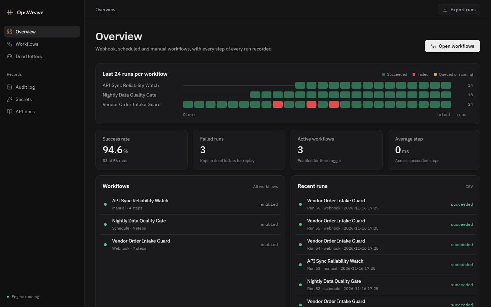
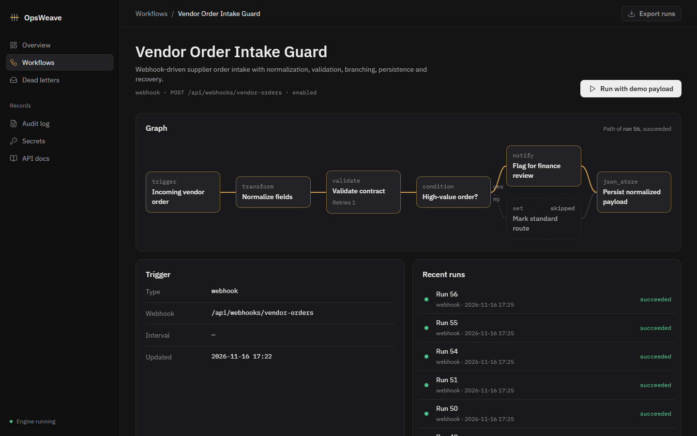
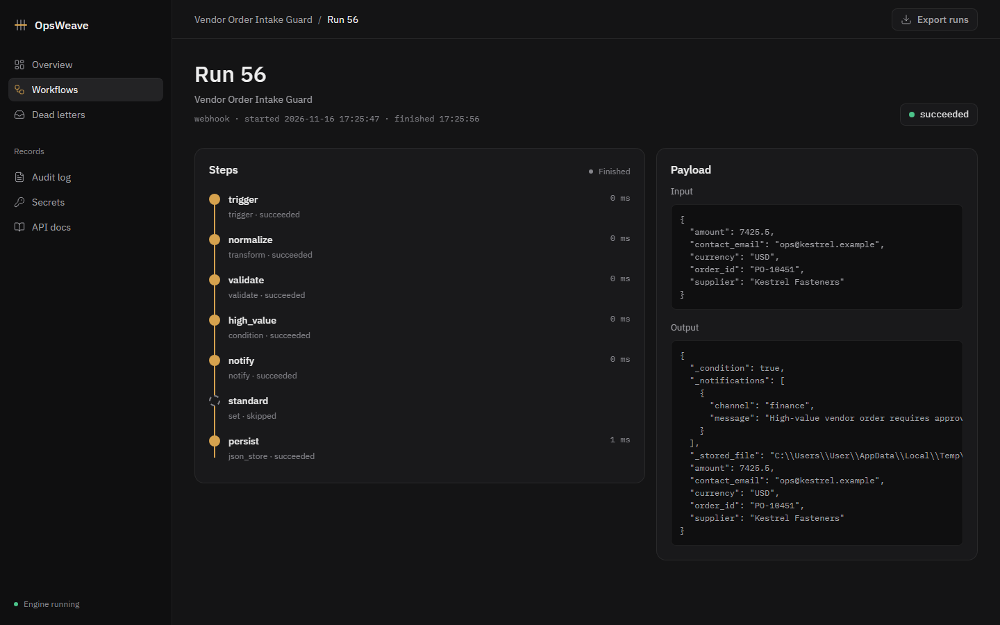
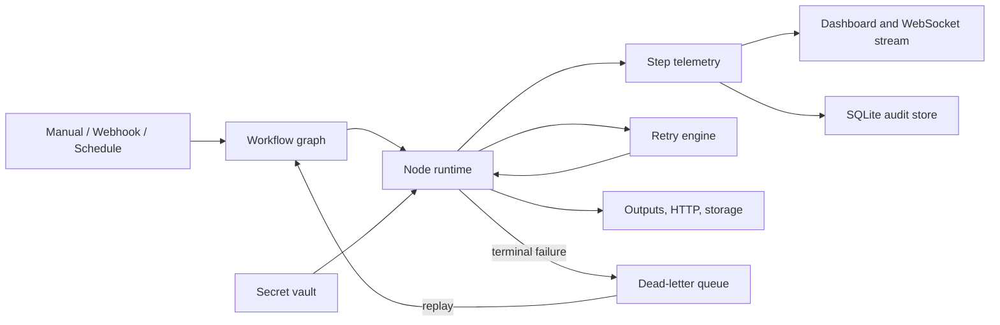

<div align="center">

# OpsWeave

**Workflow automation that records every step, retries what can be retried, and keeps what failed so you can replay it.**

[English](README.md) · [Русский](README.ru.md) · [Қазақша](README.kk.md)


</div>

<p align="center">
  
</p>

## What it is

A lot of automation starts as a script and later needs reliability: schedules, retries, secrets, an audit trail and a way to replay failures. OpsWeave is that next step in one self-contained project.

You describe an automation as a graph of steps. It runs from a manual click, a webhook or a schedule. Every step is recorded with its timing and a hash of its input and output. Transient failures are retried. A run that fails for good keeps its original payload in a dead-letter queue, so you can fix the data and replay it.

| Piece | What it does |
|---|---|
| **Workflow graph** | Steps as a DAG with yes/no branches |
| **Triggers** | Manual, webhook (with idempotency keys) and scheduled |
| **Run history** | Every attempt of every step: latency, error, payload hashes |
| **Dead letters** | Failed payloads kept for a one-time replay |
| **Secret vault** | Encrypted values used as `${SECRET:NAME}` in node config |
| **Live view** | WebSocket stream of a run while it executes |

## Screenshots

<table>
  <tr>
    <td width="50%"><br><sub>A workflow graph. The path the latest run took is drawn in ochre, the skipped branch is dashed</sub></td>
    <td width="50%"><br><sub>A run: every step on one line with its attempts, latency and error</sub></td>
  </tr>
</table>

## How a run goes



## Node types

| Node | Purpose |
|---|---|
| `trigger` | Entry point of a run |
| `set` | Add static fields to the payload |
| `transform` | Normalize, cast and map values |
| `validate` | Required fields, regex, ranges, allowed values |
| `condition` | Route the run along yes/no edges |
| `http` | Call an external JSON API |
| `delay` | Pause a step |
| `notify` | Attach an operational notification to the run |
| `json_store` | Save the payload as a JSON artifact for the next system |

Each node has its own retry policy: up to 5 retries with a delay of 0 to 30 seconds between attempts.

## Quick start

```bash
python -m venv .venv
source .venv/bin/activate  # Windows: .venv\Scripts\activate
pip install -r requirements.txt
python scripts/seed_demo.py
uvicorn app.main:app --reload
```

| Where | URL |
|---|---|
| Dashboard | `http://127.0.0.1:8000` |
| API docs | `http://127.0.0.1:8000/docs` |
| Health | `http://127.0.0.1:8000/api/health` |

The seed script creates three workflows:

| Workflow | Trigger | What it shows |
|---|---|---|
| **Vendor Order Intake Guard** | Webhook | Normalization, contract validation, a high-value branch, persistence |
| **Nightly Data Quality Gate** | Schedule | A health snapshot with a freshness check |
| **API Sync Reliability Watch** | Manual | A reusable sync check with retries and dead-letter protection |

## Try it

Send an order to the demo webhook:

```bash
curl -X POST http://127.0.0.1:8000/api/webhooks/vendor-orders \
  -H 'Content-Type: application/json' \
  -d '{
    "order_id": "PO-1042",
    "supplier": "Northstar Components",
    "amount": "7425.50",
    "currency": "usd",
    "contact_email": " OPS@NORTHSTAR.EXAMPLE "
  }'
```

The run normalizes the payload, validates it, classifies the order as high-value, attaches a finance-review notification and saves the final artifact.

To see recovery, send an invalid email address. The validation step retries by its policy, the run ends as failed, and the original payload appears in **Dead letters**. Correct it and replay.

## What's new in this version

| What | How it works now |
|---|---|
| Pages | Every page of the interface renders on current Starlette |
| Deleting a workflow | Removes its runs, steps and dead letters with it |
| Saving a workflow | Cycles, a webhook without a slug, a schedule without an interval and a duplicate slug are rejected with a clear `400` |
| Updates | Errors from `PATCH` are `400`, and `"definition": null` is handled |
| Broken definitions | A stored definition that no longer validates fails the run and creates a dead letter instead of waiting in the queue forever |
| Restart | Runs left queued or running by a stopped process are marked failed on startup and sent to dead letters |
| Scheduler | Survives a failing tick and does not stack a new run while the previous one is still queued or running |
| Replay | A dead letter can be replayed once. A second replay returns `409` |
| Secrets | A value stored under another `OPSWEAVE_SECRET_KEY` gives a clear error |
| Interface | A graphite theme. Each workflow has a strip of its last 24 runs, the graph shows the path the latest run took, a run shows its steps on one line |

## Secret vault

```bash
curl -X POST http://127.0.0.1:8000/api/secrets \
  -H 'Content-Type: application/json' \
  -d '{"name":"CRM_TOKEN","value":"secret-value"}'
```

Reference it in a node:

```json
{
  "headers": {
    "Authorization": "Bearer ${SECRET:CRM_TOKEN}"
  }
}
```

Secrets are encrypted before they reach SQLite. List endpoints never return a value.

## Protecting writes

Set `OPSWEAVE_WRITE_API_KEY`. Once it is set, workflow changes, manual runs, replays and secret writes require a header:

```text
X-OpsWeave-Key: your-key
```

Webhook routes stay open so external systems can call them.

## API

| Method | Path | Purpose |
|---|---|---|
| `GET` | `/api/health`, `/api/stats` | Health and overview numbers |
| `GET` `POST` | `/api/workflows` | List and create workflows |
| `GET` `DELETE` | `/api/workflows/{id}` | Read or delete a workflow |
| `POST` | `/api/workflows/{id}/run` | Start a manual run |
| `POST` | `/api/webhooks/{slug}` | Trigger by webhook, `X-Idempotency-Key` supported |
| `GET` | `/api/runs`, `/api/runs/{id}` | Run history with steps |
| `POST` | `/api/runs/{id}/replay` | Replay a run |
| `GET` | `/api/dead-letters` | Failed payloads |
| `POST` | `/api/dead-letters/{id}/replay` | Replay a dead letter once |
| `GET` `POST` | `/api/secrets` | List names, store a secret |
| `GET` | `/api/runs-export.csv` | Run history as CSV |
| `GET` | `/api/audit` | Audit log |
| `WS` | `/ws/runs/{id}` | Live run updates |

## What is stored

Workflows and their graphs, run state and trigger metadata, every node attempt with latency and payload hashes, encrypted secrets, audit events, webhook idempotency keys, and dead letters with their replay state. SQLite runs in WAL mode, so the dashboard can read while workflows write.

## Configuration

| Variable | Default |
|---|---|
| `OPSWEAVE_DB_PATH` | `data/opsweave.db` |
| `OPSWEAVE_SECRET_KEY` | `dev-only-change-me`, change it in production |
| `OPSWEAVE_WRITE_API_KEY` | empty, writes are open |
| `OPSWEAVE_HOST` | `0.0.0.0` |
| `OPSWEAVE_PORT` | `8000` |

## Tests

```bash
pytest -q        # 17 tests, no network
```

They cover graph execution and branching, retries, dead-letter creation and replay, secret encryption, workflow validation, the scheduler and the API. GitHub Actions runs them on every push.

## Docker

```bash
docker compose up --build
```

State lives in `./data` and survives restarts.

## Project layout

```text
app/
  config.py        settings
  crypto.py        encrypted secret box
  db.py            SQLite schema and connections
  engine.py        graph execution, retries, node runtime
  main.py          API, WebSocket and pages
  models.py        workflow contracts
  repository.py    persistence
  scheduler.py     scheduled runs
  templates/       interface
  static/          styles
scripts/
  seed_demo.py     demo workflows
docs/              architecture, API examples, security notes, screenshots
tests/
```

---

<div align="center">

Built by **[Koncha Artyom](https://github.com/artyom129)** · MIT License

</div>
