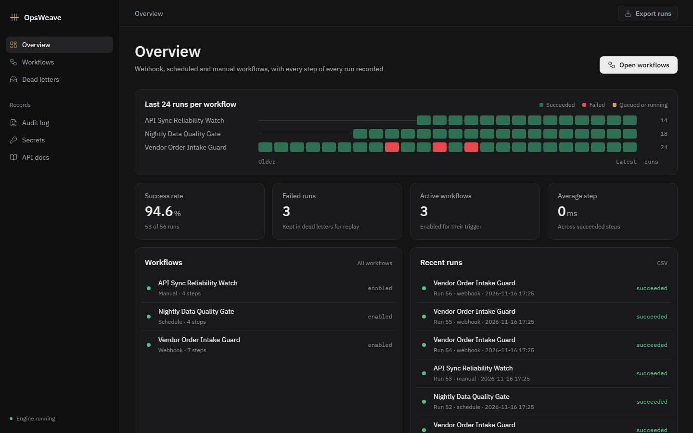
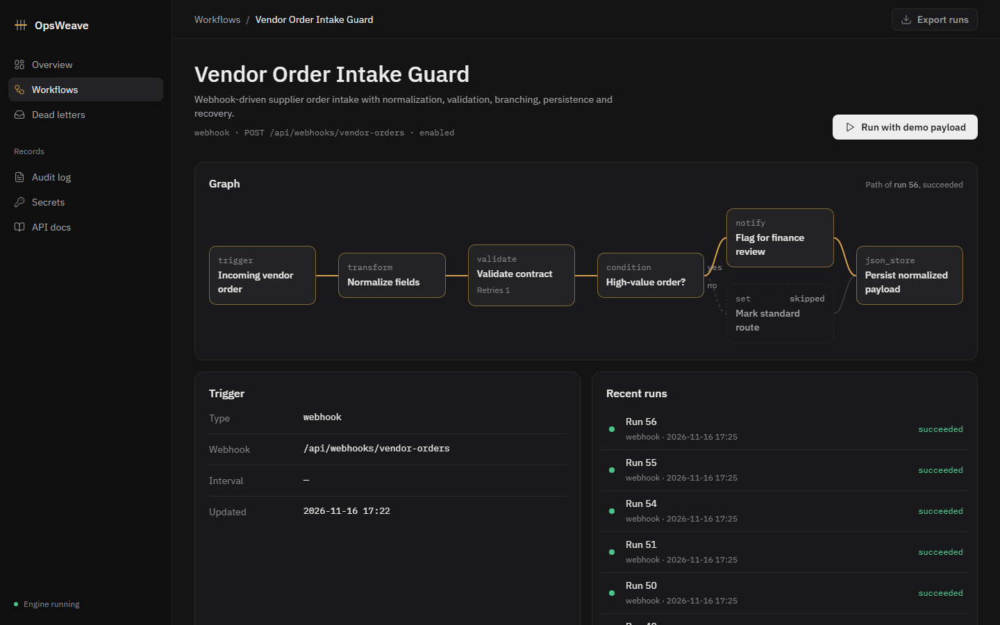
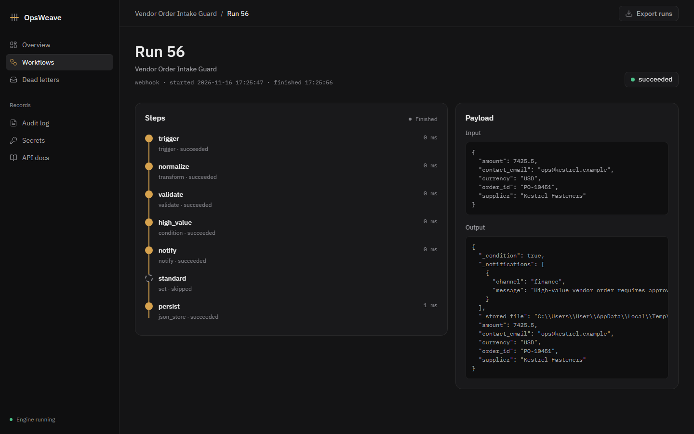
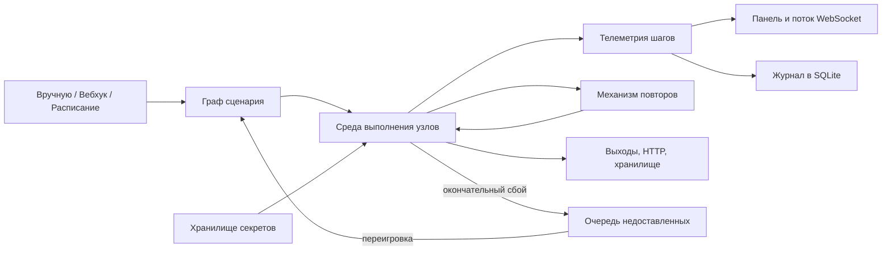

<div align="center">

# OpsWeave

**Автоматизация, которая записывает каждый шаг, повторяет то, что можно повторить, и сохраняет упавшее, чтобы его можно было переиграть.**

[English](README.md) · [Русский](README.ru.md) · [Қазақша](README.kk.md)


</div>

<p align="center">
  
</p>

## Что это

Многие автоматизации начинаются со скрипта, а потом им нужна надёжность: расписания, повторы, секреты, журнал действий и способ переиграть сбои. OpsWeave это следующий шаг в одном самодостаточном проекте.

Вы описываете автоматизацию как граф шагов. Она запускается кликом, вебхуком или по расписанию. Каждый шаг записывается со временем выполнения и хешем входа и выхода. Временные сбои повторяются. Запуск, который упал окончательно, оставляет исходные данные в очереди недоставленных, и вы можете исправить данные и переиграть.

| Часть | Что делает |
|---|---|
| **Граф сценария** | Шаги в виде DAG с ветками да/нет |
| **Триггеры** | Ручной, вебхук (с ключами идемпотентности) и по расписанию |
| **История запусков** | Каждая попытка каждого шага: задержка, ошибка, хеши данных |
| **Недоставленные** | Упавшие данные хранятся для однократной переигровки |
| **Хранилище секретов** | Зашифрованные значения, используются как `${SECRET:NAME}` в настройках узла |
| **Живой вид** | Поток WebSocket с ходом запуска во время выполнения |

## Скриншоты

<table>
  <tr>
    <td width="50%"><br><sub>Граф сценария. Путь последнего запуска нарисован охрой, пропущенная ветка пунктиром</sub></td>
    <td width="50%"><br><sub>Запуск: все шаги на одной линии с попытками, задержкой и ошибкой</sub></td>
  </tr>
</table>

## Как проходит запуск



## Типы узлов

| Узел | Назначение |
|---|---|
| `trigger` | Точка входа запуска |
| `set` | Добавить постоянные поля в данные |
| `transform` | Привести, преобразовать и переименовать значения |
| `validate` | Обязательные поля, regex, диапазоны, допустимые значения |
| `condition` | Направить запуск по рёбрам да/нет |
| `http` | Вызвать внешний JSON API |
| `delay` | Приостановить шаг |
| `notify` | Прикрепить к запуску операционное уведомление |
| `json_store` | Сохранить данные как JSON-артефакт для следующей системы |

У каждого узла своя политика повторов: до 5 повторов с паузой от 0 до 30 секунд между попытками.

## Быстрый старт

```bash
python -m venv .venv
source .venv/bin/activate  # Windows: .venv\Scripts\activate
pip install -r requirements.txt
python scripts/seed_demo.py
uvicorn app.main:app --reload
```

| Что | Адрес |
|---|---|
| Панель | `http://127.0.0.1:8000` |
| Документация API | `http://127.0.0.1:8000/docs` |
| Health | `http://127.0.0.1:8000/api/health` |

Скрипт создаёт три сценария:

| Сценарий | Триггер | Что показывает |
|---|---|---|
| **Vendor Order Intake Guard** | Вебхук | Нормализация, проверка контракта, ветка для крупных заказов, сохранение |
| **Nightly Data Quality Gate** | Расписание | Снимок состояния с проверкой свежести |
| **API Sync Reliability Watch** | Вручную | Повторяемая проверка синхронизации с повторами и защитой через недоставленные |

## Попробуйте

Отправьте заказ на демо-вебхук:

```bash
curl -X POST http://127.0.0.1:8000/api/webhooks/vendor-orders \
  -H 'Content-Type: application/json' \
  -d '{
    "order_id": "PO-1042",
    "supplier": "Northstar Components",
    "amount": "7425.50",
    "currency": "usd",
    "contact_email": " OPS@NORTHSTAR.EXAMPLE "
  }'
```

Запуск нормализует данные, проверяет их, относит заказ к крупным, добавляет уведомление для финансов и сохраняет итоговый артефакт.

Чтобы увидеть восстановление, отправьте неверный email. Шаг проверки повторится по своей политике, запуск закончится ошибкой, а исходные данные появятся в **Dead letters**. Исправьте их и переиграйте.

## Что нового в этой версии

| Что | Как теперь работает |
|---|---|
| Страницы | Все страницы интерфейса отображаются на актуальной Starlette |
| Удаление сценария | Вместе с ним удаляются его запуски, шаги и недоставленные |
| Сохранение сценария | Циклы, вебхук без slug, расписание без интервала и повтор slug отклоняются понятным `400` |
| Обновления | Ошибки `PATCH` это `400`, а `"definition": null` обрабатывается |
| Сломанные определения | Сохранённое определение, которое больше не проходит проверку, завершает запуск ошибкой и создаёт запись в недоставленных, а не ждёт в очереди вечно |
| Перезапуск | Запуски, оставшиеся в очереди или в работе после остановки процесса, при старте помечаются как упавшие и уходят в недоставленные |
| Планировщик | Переживает сбойный тик и не копит новый запуск, пока предыдущий в очереди или в работе |
| Переигровка | Недоставленную запись можно переиграть один раз. Вторая переигровка возвращает `409` |
| Секреты | Значение, сохранённое под другим `OPSWEAVE_SECRET_KEY`, даёт понятную ошибку |
| Интерфейс | Графитовая тема. У каждого сценария полоса из последних 24 запусков, граф показывает путь последнего запуска, запуск показывает шаги в одну линию |

## Хранилище секретов

```bash
curl -X POST http://127.0.0.1:8000/api/secrets \
  -H 'Content-Type: application/json' \
  -d '{"name":"CRM_TOKEN","value":"secret-value"}'
```

Использование в узле:

```json
{
  "headers": {
    "Authorization": "Bearer ${SECRET:CRM_TOKEN}"
  }
}
```

Секреты шифруются до попадания в SQLite. Списки значений никогда не возвращают.

## Защита записи

Задайте `OPSWEAVE_WRITE_API_KEY`. После этого изменения сценариев, ручные запуски, переигровки и запись секретов требуют заголовок:

```text
X-OpsWeave-Key: your-key
```

Маршруты вебхуков остаются открытыми, чтобы их могли вызывать внешние системы.

## API

| Метод | Путь | Назначение |
|---|---|---|
| `GET` | `/api/health`, `/api/stats` | Здоровье и числа обзора |
| `GET` `POST` | `/api/workflows` | Список и создание сценариев |
| `GET` `DELETE` | `/api/workflows/{id}` | Чтение или удаление сценария |
| `POST` | `/api/workflows/{id}/run` | Ручной запуск |
| `POST` | `/api/webhooks/{slug}` | Запуск по вебхуку, поддерживается `X-Idempotency-Key` |
| `GET` | `/api/runs`, `/api/runs/{id}` | История запусков с шагами |
| `POST` | `/api/runs/{id}/replay` | Переиграть запуск |
| `GET` | `/api/dead-letters` | Упавшие данные |
| `POST` | `/api/dead-letters/{id}/replay` | Переиграть недоставленную запись один раз |
| `GET` `POST` | `/api/secrets` | Список имён, сохранение секрета |
| `GET` | `/api/runs-export.csv` | История запусков в CSV |
| `GET` | `/api/audit` | Журнал аудита |
| `WS` | `/ws/runs/{id}` | Живые обновления запуска |

## Что хранится

Сценарии и их графы, состояние запусков и данные триггеров, каждая попытка узла с задержкой и хешами данных, зашифрованные секреты, события аудита, ключи идемпотентности вебхуков и недоставленные записи с состоянием переигровки. SQLite работает в режиме WAL, поэтому панель может читать, пока сценарии пишут.

## Настройка

| Переменная | По умолчанию |
|---|---|
| `OPSWEAVE_DB_PATH` | `data/opsweave.db` |
| `OPSWEAVE_SECRET_KEY` | `dev-only-change-me`, в продакшене замените |
| `OPSWEAVE_WRITE_API_KEY` | пусто, запись открыта |
| `OPSWEAVE_HOST` | `0.0.0.0` |
| `OPSWEAVE_PORT` | `8000` |

## Тесты

```bash
pytest -q        # 17 тестов, без сети
```

Они покрывают выполнение графа и ветвление, повторы, создание и переигровку недоставленных, шифрование секретов, проверку сценариев, планировщик и API. GitHub Actions запускает их при каждом пуше.

## Docker

```bash
docker compose up --build
```

Состояние лежит в `./data` и переживает перезапуски.

## Структура проекта

```text
app/
  config.py        настройки
  crypto.py        шифрованное хранилище секретов
  db.py            схема SQLite и соединения
  engine.py        выполнение графа, повторы, среда узлов
  main.py          API, WebSocket и страницы
  models.py        контракты сценариев
  repository.py    хранение данных
  scheduler.py     запуски по расписанию
  templates/       интерфейс
  static/          стили
scripts/
  seed_demo.py     демо-сценарии
docs/              архитектура, примеры API, заметки по безопасности, скриншоты
tests/
```

---

<div align="center">

Автор: **[Koncha Artyom](https://github.com/artyom129)** · Лицензия MIT

</div>
